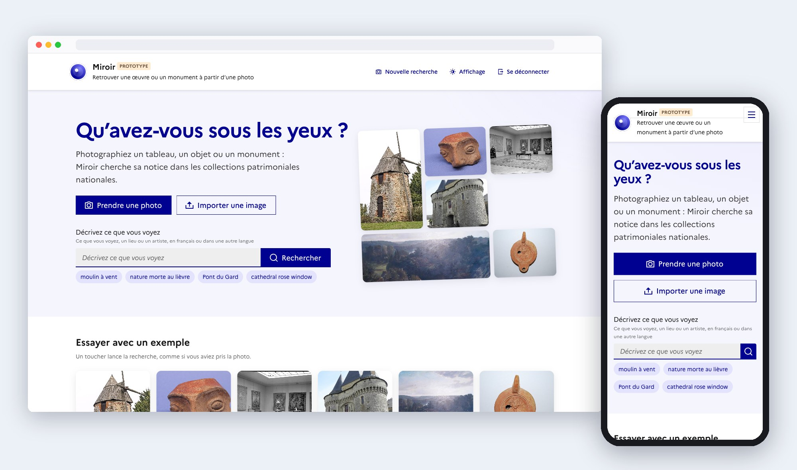
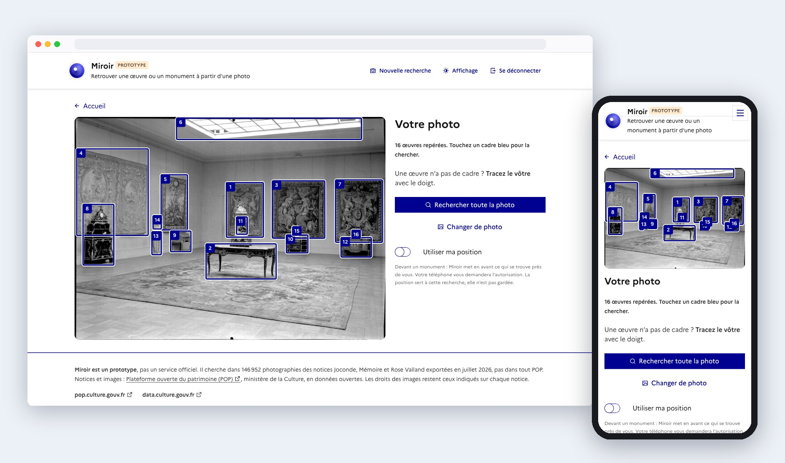
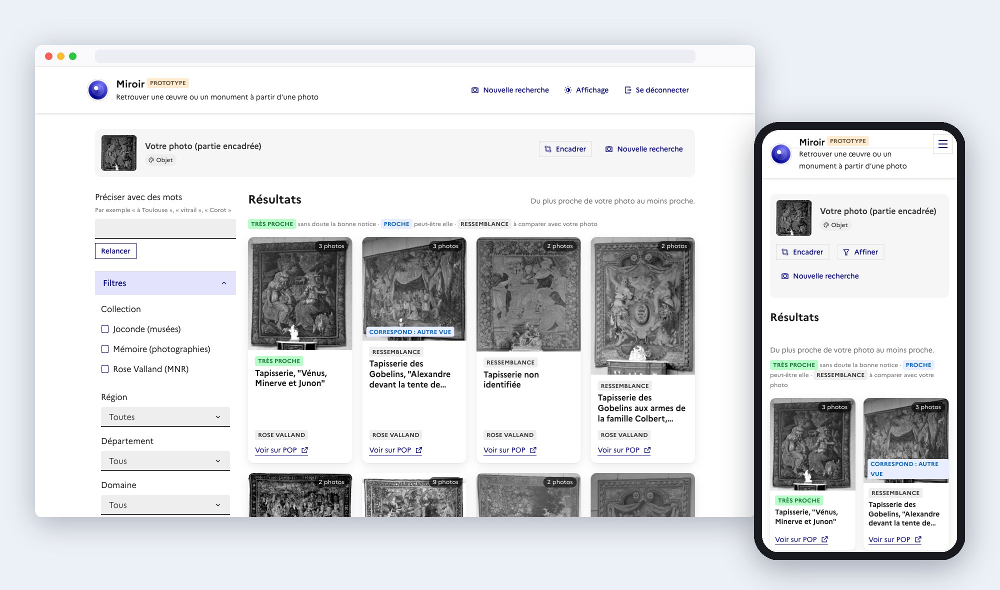
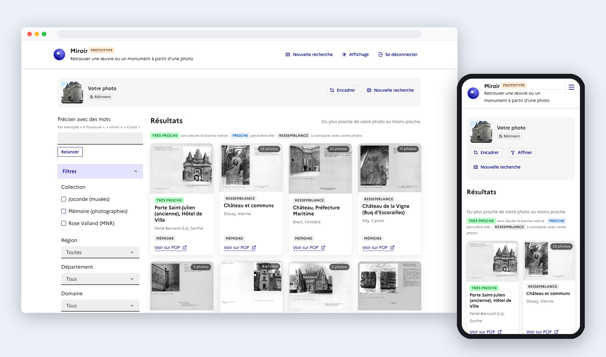
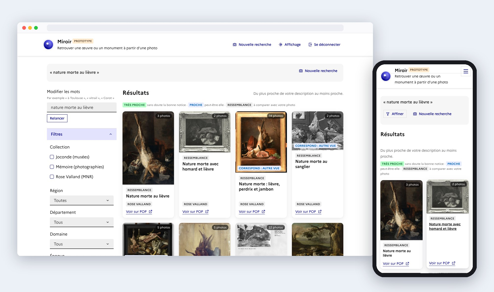
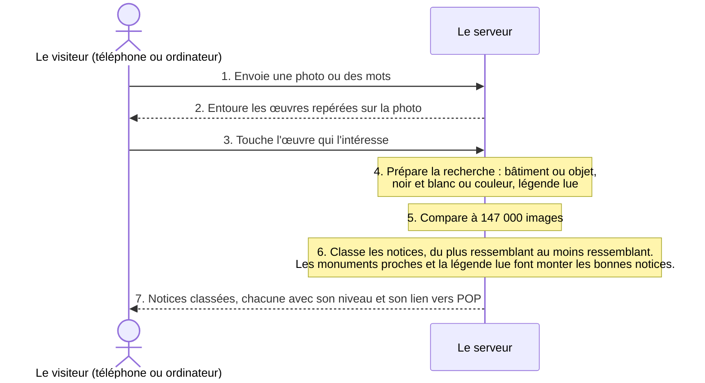

# MIROIR

**Une recherche par l'image dans [POP](https://pop.culture.gouv.fr/), la plateforme ouverte du patrimoine.** On prend une photo d'un monument ou d'une œuvre, et le site retrouve sa notice dans POP en moins d'une seconde, avec des modèles ouverts.

Sur 680 photos de test, cherchées parmi 147 000 images, la bonne notice arrive dans les 10 premières réponses :

- **97 %** des fois pour un bâtiment photographié au téléphone, avec la position du téléphone (Google Lens s'en sert aussi) ;
- **94 %** pour une œuvre de musée photographiée ;
- **89 %** pour un vieux tirage sur carton, dont le site lit la légende ;
- **78 %** (dans les 5 premières) pour une œuvre repérée sur une photo de salle de musée.

Pour l'instant, un grand point faible : sans la position du téléphone, un bâtiment n'est dans les 10 premières réponses qu'une fois sur trois (37 % ; 43 % dans les 50 premières). Le site ne couvre encore que 5 % de POP (101 000 notices sur 2,1 millions). La prochaine étape est d'indexer tout POP, pour environ 140 € de calcul, puis de le tester avec de vrais visiteurs.

## Sommaire

- [Le besoin](#le-besoin)
- [Ce que fait le prototype](#ce-que-fait-le-prototype)
- [Résultats mesurés](#résultats-mesurés)
- [Comment ça marche](#comment-ça-marche)
- [Ce que j'ai essayé](#ce-que-jai-essayé)
- [Passer à tout POP](#passer-à-tout-pop)
- [Limites et risques](#limites-et-risques)
- [Prochaines étapes](#prochaines-étapes)
- [Annexe : ce que d'autres ont fait](#annexe--ce-que-dautres-ont-fait)
- [Documentation technique](#documentation-technique)

## Le besoin

- POP compte 2,1 millions de notices avec au moins une image.
- On n'y cherche qu'avec des mots : nom, lieu, auteur, référence.
- Un visiteur, un agent ou un chercheur a souvent une image, sans le nom ni la référence.
- POP ne propose pas de recherche à partir d'une image.
- MIROIR fait cette recherche : une photo ou quelques mots en entrée, les notices POP les plus proches en sortie, avec leur lien.

## Ce que fait le prototype

Un premier prototype est en ligne, derrière un mot de passe communiqué sur demande. Une recherche prend moins d'une seconde ; la première après 10 minutes sans usage prend 1 à 2 minutes, le temps que le serveur et sa carte graphique (GPU) démarrent.

1. **Photo d'un bâtiment.** Le site devine qu'il s'agit d'un bâtiment et cherche parmi les photos de POP et 10 221 photos de Wikimedia Commons rattachées à 2 726 monuments. Pourquoi Commons : les photos de POP sont souvent anciennes, en noir et blanc, prises sous un seul angle ; celles de Commons, sous licence libre, sont récentes, en couleur et prises de partout, comme celles d'un visiteur. Elles ont fait passer les bâtiments trouvés sans position de 27 % à 37 %. Elles servent seulement de repère : le visiteur ne voit que des notices et des images de POP. Si la photo porte sa position, ou si le visiteur active « Utiliser ma position », les monuments proches passent en tête. La position sert à cette recherche seulement et n'est pas gardée.
2. **Photo d'une salle de musée.** Le site entoure jusqu'à 20 œuvres, les plus grandes et les plus centrales d'abord. Le visiteur touche celle qui l'intéresse.
3. **Vieux tirage sur carton.** Le site repère le carton, lit la légende manuscrite (par exemple « Beaune (Côte-d'Or), église Notre-Dame ») et s'en sert pour chercher. Le visiteur peut corriger ou retirer la légende.
4. **Recherche par mots**, en français ou dans une autre langue : « Pont du Gard », « nature morte au livre ».

Les résultats sont classés par ressemblance, du plus proche au plus lointain. Chacun porte un niveau : « Très proche », « Proche » ou « Ressemblance ». Sur les photos de test, un résultat « Très proche » est la bonne notice environ 8 fois sur 10. Des filtres (collection, région, département, domaine, période) restreignent la recherche.

Captures du site en ligne, sur ordinateur et sur téléphone :

*Photo d'une salle du Jeu de Paume, vers 1942 : le site entoure 16 œuvres ; on touche celle qu'on cherche.*

*Après avoir touché la tapisserie n° 3 : la notice Rose Valland arrive en tête, avec son lien vers POP.*

*Photo d'un monument prise par un visiteur (trouvée sur Wikimedia Commons) : le site retrouve la porte Saint-Julien à La Ferté-Bernard.*

*Recherche par mots, « nature morte au livre » : les deux œuvres qui portent ce sujet arrivent en tête.*

## Résultats mesurés

| Usage | Photos testées | Bonne notice trouvée |
| --- | --- | --- |
| Bâtiment au téléphone, avec position | 152 | 97 % dans les 10 premiers |
| Vieux tirage d'un bâtiment, sur carton | 138 | 89 % dans les 10 premiers |
| Œuvre dans une photo de salle de musée | 99 | 78 % dans les 5 premiers |
| Œuvre de musée photographiée par un visiteur | 291 | 94 % dans les 10 premiers |
| Bâtiment au téléphone, sans position | 516 | 37 % dans les 10 premiers |
| Objet vu sous un autre angle | Joconde | 43 % dans les 10 premiers |
| Description en mots | 500 | 18 % dans les 10 premiers |

### Où arrive la bonne notice

Quand la bonne notice est trouvée, elle est le plus souvent en tête : pour une œuvre de musée photographiée par un visiteur, 82 % des fois en première place.

| Usage | 1re place | 3 premières | 10 premières | 50 premières |
| --- | --- | --- | --- | --- |
| Œuvre de musée photographiée par un visiteur | 82 % | 89 % | 94 % | 96 % |
| Bâtiment au téléphone, avec position | 80 % | 89 % | 97 % | 99 % |
| Vieux tirage sur carton, légende lue | 71 % | 82 % | 89 % | 94 % |
| Œuvre dans une photo de salle (20 contours) | 64 % | 75 % | 81 % | 83 % |
| Objet vu sous un autre angle | 27 % | 35 % | 43 % | 55 % |
| Bâtiment au téléphone, sans position | 26 % | 33 % | 37 % | 43 % |
| Description en mots | 8 % | 13 % | 18 % | 27 % |

### Trouver la notice exacte, ou découvrir ses voisines

Même quand la notice exacte n'est pas dans les 10 premières réponses, ces réponses ne tombent pas au hasard :

- **Objet vu sous un autre angle.** Dans 94 % des cas manqués, les 10 premières réponses contiennent un objet du même type (médaille, monnaie, assiette…) et, dans 84 %, une œuvre du même auteur. En moyenne, 7 réponses sur 10 sont du même type que l'objet cherché.
- **Vieux tirage sur carton.** Dans 87 % des cas manqués, au moins une réponse est dans le même département. En moyenne, près de 3 réponses sur 10 sont dans la même commune que le bâtiment cherché.
- **Bâtiment au téléphone, sans position.** C'est le cas le plus faible : au moins une réponse dans le même département pour 45 % des cas manqués, dans la même commune pour 15 %.

Je pars du constat que trouver la notice exacte n'est pas le seul usage de MIROIR. C'est le choix de Google Lens ou de Pl@ntNet : plusieurs réponses classées, et la personne choisit. Des tests avec de vrais utilisateurs indiqueraient si ces voisines les intéressent autant que la réponse exacte.

*Chiffres mesurés sur la moitié des photos de test qui sert aux réglages. Trois lignes (bâtiment avec position, salle, mots) viennent de l'index sans les photos Commons.*

## Comment ça marche

En haut, ce que fait le visiteur ; sur la ligne du serveur, ce qui se passe en coulisses. Les étapes 2 et 3 ne servent que pour une photo qui montre plusieurs œuvres, comme une salle de musée. Pour une recherche par mots, le serveur passe directement à l'étape 5. Tout tourne sur des modèles ouverts, sur des serveurs que je loue.

## Ce que j'ai essayé

J'ai testé une quinzaine de pistes, chacune mesurée sur les mêmes photos ; la moitié ont été abandonnées.

| Piste | Ce que j'ai mesuré | Décision |
| --- | --- | --- |
| 9 familles de modèles d'image : DINOv2, DINOv3, SigLIP 2, PE-Core, Qwen3-VL-Embedding, EmbeddingGemma 2, MegaLoc ; Gemini et Voyage (fermés) | EmbeddingGemma 2 (ouvert) égale Gemini sur les bâtiments ; MegaLoc le dépasse sur les objets (62 % contre 51 %). DINO, attendu en tête, finit dernier | Gardés : EmbeddingGemma 2 et MegaLoc |
| Doser les deux modèles selon la photo (bâtiment ou objet, noir et blanc ou couleur) | Bâtiments au téléphone : de 18 % à 27 % | Gardé |
| Ajouter des photos Commons aux bâtiments | De 27 % à 37 % | Gardé |
| Position du téléphone | De 32 % à 97 % en favorisant les monuments proches ; 83 % en écartant tout ce qui est à plus de 2 km | Gardé, sans rien écarter |
| Lire la légende du carton (Qwen3-VL 4B, ouvert) | Vieux tirages : de 46 % à 89 % | Gardé |
| Découper le carton pour ne garder que la photo | De 46 % à 21 % : les tirages de POP sont sur le même carton | Abandonné |
| Faire décrire la photo par un modèle de vision, puis chercher ce texte | +6 points sur les objets, mais avec un modèle fermé et plus lent | Non retenu |
| Comparer les détails point par point (ALIKED + LightGlue) | +12 points pour la première réponse en salle, mais 3 s de plus par recherche | Non retenu |
| Contours des œuvres : Grounding DINO, OWLv2, Qwen3-VL | Scores égaux ; Qwen3-VL prend des dizaines de secondes | Gardé : Grounding DINO, le plus léger |
| Montrer d'abord les contours les plus grands et centraux | Photo de salle : de 54 % à 78 % | Gardé |
| Mots : texte des notices, sens de l'image, mélange | 5 %, 17 % et 18 % des descriptions trouvées | Gardé : le mélange |
| Reformuler les mots de la recherche | Moins bon | Abandonné |
| Passer les photos en noir et blanc | Pas de gain | Abandonné |
| Compresser MegaLoc à 1 024 dimensions | −18 points sur les bâtiments | Abandonné |
| Filtre « Musée » | +0,2 point | Abandonné |

## Passer à tout POP

Indexer tout POP coûte environ 140 € de calcul, en 14 heures. On peut aussi avancer par étapes, en commençant par les bâtiments pour environ 50 €.

| Option | Images | Coût, marge de 25 % comprise | Durée |
| --- | --- | --- | --- |
| Tout POP | 2 138 564 | ≈ 140 € | ≈ 14 h |
| Une image par monument ou objet | 859 906 | ≈ 57 € | ≈ 6 h |
| Étape 1 : les bâtiments | 729 402 | ≈ 48 € | ≈ 5 h |
| Étape 2 : les objets | 1 409 162 | ≈ 92 € | ≈ 9 h |

Tout POP compte 2,1 millions de notices avec image : Mémoire 1,27 million, Joconde 605 000, Palissy 202 000, Mérimée 40 000, Rose Valland 2 400. Les exports annoncent 4,3 millions d'images, mais la moitié sont des doublons : les images de Mérimée et Palissy sont celles de Mémoire, et 800 000 fichiers Joconde existent sous deux noms.

Le serveur de POP tient le rythme : un test a téléchargé sans erreur de serveur, et tout POP (0,52 To) se téléchargerait en 4 heures environ.

**Qualité à grande échelle.** Plus il y a d'images, plus il y a de sosies. Quand l'index est passé de 22 000 à 137 000 images, la plupart des usages ont perdu 3 à 7 points ; les objets vus sous un autre angle, 18 points, car beaucoup de monnaies et de médailles se ressemblent.

| Usage, bonne notice dans les 10 premiers | 22 000 images | 137 000 images |
| --- | --- | --- |
| Œuvre de musée photographiée par un visiteur | 94 % | 95 % |
| Œuvre dans une photo de salle | 90 % | 87 % |
| Vieux tirage, sans lire la légende | 51 % | 46 % |
| Bâtiment au téléphone, sans position | 25 % | 18 % |
| Objet vu sous un autre angle | 61 % | 43 % |

Tout POP compte 15 fois plus d'images : il faut s'attendre à une nouvelle baisse, surtout pour les objets. Ce qui restreint les candidats la compense : la position du téléphone, la légende lue et les filtres (collection, région, période). C'est aussi ce que la mesure finale devra vérifier.

**Vitesse à grande échelle.** Mesuré sur 3 millions d'images, plus que tout POP : la recherche prend environ une demi-seconde sur le serveur, comme aujourd'hui. Le démarrage à froid s'allongerait, car il y a plus de données à charger ; il faudrait garder le serveur allumé pendant les tests.

**Hébergement.** Tout POP tient sur le même type de serveur qu'aujourd'hui, en rangeant les données autrement : un premier tri rapide garde 2 000 candidats, puis seuls ceux-là sont comparés en détail. La qualité baisse d'un point au plus sur mes tests. Le serveur coûterait environ 1,25 € par heure d'usage, contre 1,10 € aujourd'hui, et s'éteint seul après 10 minutes sans recherche.

**Ce que le projet a coûté.** Environ 26 € de calcul pour tous les essais (29 $ : 22,40 $ chez Modal, 6,50 $ chez OpenRouter), plus les heures de serveur du site en ligne, qui ne sont pas comptées dans ce total.

**Des prix indicatifs.** L'installation actuelle sert aux tests : ses prix ne valent pas devis pour un service en production. Le serveur loue une carte graphique à l'heure et s'éteint après 10 minutes sans recherche. Un démarrage à froid coûte peu (1 à 2 minutes de serveur, quelques centimes) ; son vrai défaut est l'attente du premier visiteur. Garder le serveur allumé en permanence coûterait environ 900 € par mois (1,25 € × 720 heures). Avec beaucoup d'usage, ce coût s'amortit vite : une recherche occupe la carte graphique environ 0,2 seconde, donc un serveur peut traiter des milliers de recherches par heure, pour moins d'un centime chacune. L'hébergement d'un vrai service (disponibilité, hébergeur, plusieurs serveurs) reste à chiffrer.

## Limites et risques

- **Aucun vrai visiteur ne l'a encore utilisé.** Les chiffres viennent de photos de test ; il faut des essais avec de vrais utilisateurs.
- **Sans la position du téléphone, un bâtiment n'est trouvé qu'une fois sur trois.** Ajouter des photos Commons à tous les bâtiments (2 726 sur 3 924 en ont aujourd'hui) est la prochaine piste.
- **Droits des images.** Aucune image n'est envoyée à un service d'IA tiers : tout tourne sur des modèles ouverts que j'héberge. Les photos Commons servent seulement à la recherche ; le site n'affiche que des images de POP.

## Prochaines étapes

1. **Indexer tout POP.** Environ 14 heures de calcul, pour environ 140 € ; ou d'abord les bâtiments, en 5 heures, pour environ 48 €.
2. **Ajouter des photos Commons à tous les bâtiments**, pour mieux reconnaître une façade photographiée sans la position du téléphone. Surtout du téléchargement : quelques euros de calcul.
3. **Faire des tests avec de vrais utilisateurs**, sur place et en ligne, pour savoir quoi améliorer dans la recherche et dans l'interface.

## Annexe : ce que d'autres ont fait

- **Google Lens** (Google, depuis 2017). Compare la photo à un immense index d'images du web. Pour un lieu, il se sert aussi de la position du téléphone pour départager des monuments qui se ressemblent, et il montre une liste de correspondances visuelles plutôt qu'une seule réponse. *J'en reprends la position et la liste de résultats proches.*
- **[Pl@ntNet](https://www.cirad.fr/nos-activites-notre-impact/notre-impact/recits-d-impact/plantnet)** (Cirad, INRAE, Inria, IRD, depuis 2013). Identifie une plante en comparant la photo à environ 2,9 millions d'images, et propose plusieurs espèces classées.
- **[iNaturalist](https://www.inaturalist.org/blog/84677-introducing-the-inaturalist-geomodel)** (Geomodel, depuis 2023). Combine la reconnaissance d'image et le lieu de la photo pour mettre en tête les espèces attendues à cet endroit. *C'est le principe de la position dans MIROIR : favoriser ce qui est proche, sans rien exclure.*
- **[GallicaPix](https://www.erudit.org/en/journals/documentation/2019-v65-n2-documentation04848/1063786ar/)** (BnF, vers 2019). Classe les illustrations de Gallica par genre (photo, dessin, carte) grâce à l'apprentissage profond. *Même terrain, le patrimoine français ; mais la recherche part de mots et de catégories, pas d'une photo.*
- **[Replica](https://www.epfl.ch/labs/dhlab/projects/replica/)** (EPFL et Fondation Giorgio Cini, 2015-2019). Moteur de recherche visuelle sur environ 730 000 photographies d'œuvres d'art : on part d'une image pour trouver les œuvres qui lui ressemblent.

## Documentation technique

- [Prototype](docs/prototype.md) : ce qui est en ligne et comment le déployer
- [Spécification fonctionnelle](docs/functional-spec.md) : pour qui, quoi, comment on juge
- [Spécification technique](docs/technical-spec.md) : données, modèles, index, API, évaluation
- [Expériences](docs/experiments.md) et [résultats détaillés](docs/results.md)
- [Développement](docs/developpement.md) : installer, lancer les tests, contribuer

Les données et les images ne sont pas dans ce dépôt : elles viennent des exports ouverts de POP.

## Licence

Code publié sous [Licence Ouverte / Open Licence 2.0 (Etalab)](LICENSE). Les notices et les images restent sous les conditions de POP et de leurs auteurs.
