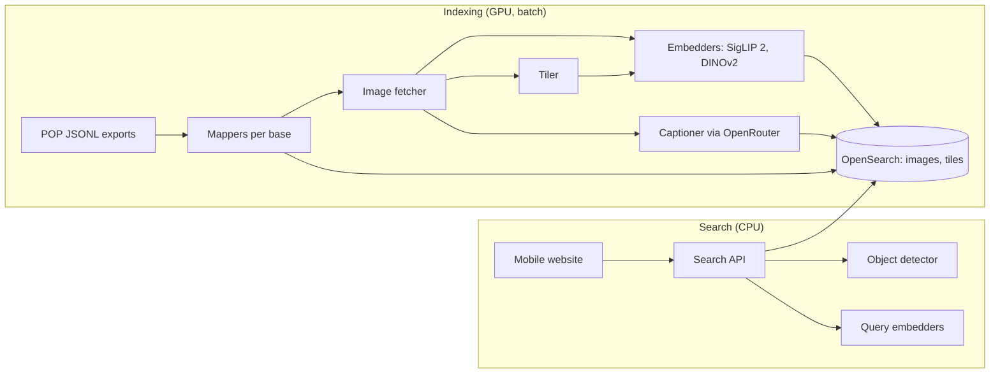

# MIROIR: technical specification

Status: draft for the PoC. Last updated 2026-10-12. Read [functional-spec.md](functional-spec.md) first.

## 1. Overview



The indexing pipeline turns POP records into one OpenSearch document per image. Each document holds image vectors and the record's text and filter fields. A second index holds vectors for image tiles, used for detail search. The search API embeds the query, runs one hybrid query (text plus vectors, with filters), groups hits by building or object, and decides between "match" and "not found".

Everything runs in Docker so the stack can move to the Ministry's cloud unchanged. Open models run on our own machines. Closed models, reached through OpenRouter, take part in the experiments as reference points ([experiments.md](experiments.md)).

## 2. Stack

| Part | Choice |
|---|---|
| Language | Python 3.12 for pipeline, API and evaluation |
| API | FastAPI |
| Models | PyTorch with Hugging Face `transformers` |
| Search | OpenSearch with the k-NN plugin (Faiss HNSW) and a hybrid search pipeline |
| Website | SvelteKit with Tailwind, phone-first |
| Captions | A vision model through OpenRouter, picked in week 1 on cost and French quality |
| Deployment | Docker Compose: `opensearch`, `api`, `web`, `worker`. A GPU machine runs the indexing jobs |

## 3. Data

### 3.1 Input

Each POP export is a folder holding `<base>.jsonl` (one record per line, POP field codes), `metadata.json` (the query and count) and `field-docs.json` (field labels). The PoC starts from three exports:

| Export | Records | Kept | Images | Notes |
|---|---|---|---|---|
| `memoire` | 66,000 | 65,989 | 65,989 | One image per record (`IMG`). `VIDEO` lists size variants of the same file, not extra views |
| `joconde` | 33,000 | 32,997 | 54,825 | 12,000 records have 2 or more views |
| `rose-valand` (base `rose-valland`, Mongo collection `mnr`) | 2,400 | 2,400 | 16,961 | Median 4 images per record, max 52 |

"Kept" counts records left with at least one image after the skips in 3.3: 101,386 records and 137,775 images in all. `uv run miroir records build` writes them to `records.parquet` and `images.parquet` in `MIROIR_DATA_DIR`, and warns when a count differs from this table.

The full export of every POP record with an image (3.4) uses the same format and adds Mérimée, Palissy and Muséofile. `uv run miroir records build-full` maps it into separate tables (11.1); each new mapper keeps only the fields of 3.2.

### 3.2 Common record model

Every mapper turns a POP record into this shape:

| Field | Type | Source examples |
|---|---|---|
| `ref` | keyword | `REF` |
| `collection` | keyword | `base`: `joconde`, `memoire` or `rose-valland` |
| `entity_id` | keyword | Mémoire: first `LBASE` value starting with `PM` (object), else the first starting with `PA` (building), else `REF`. When both are present the photo shows the object (1,414 records), so `PM` wins. Other bases: `REF` |
| `title` | text | Joconde/Rose Valland `TITR`; Mémoire `EDIF`, then `LEG`. Empty for 11,760 Joconde records: show `denomination` instead |
| `description` | text | Joconde/Rose Valland `DESC` then `HIST`; Mémoire `LEG`. Joined, first 2,000 characters |
| `denomination` | keyword[] | `DENO`, `MCL` |
| `domain` | keyword[] | `DOMN`, `DOM` |
| `authors` | keyword[] + text | `AUTR`, `AUTP` |
| `period` | keyword[] | `EPOQ`, `PERI`, `MILL`, decade of `DATPV` ("années 1940") |
| `region`, `departement`, `commune` | keyword | `REGION`/`REG`, `DPT`/`DPT_LETTRE`, `VILLE_M`/`COM` (first value; `departement` is the name, not the number) |
| `publishable` | boolean | `false` when Joconde `DIFFU` is "non" or Mémoire `DIFF` asks for permission |
| `pop_url` | keyword | `https://pop.culture.gouv.fr/notice/<mongo collection>/<REF>` |
| `linked_refs` | keyword[] | Rose Valland `RENV`: refs of related records in the same base. A Jeu de Paume room photo lists the artworks it shows; each artwork lists its room photo(s). Empty elsewhere |
| `photographers`, `photo_date` | keyword[], keyword | Mémoire `AUTP` and `DATPV` as written (`DATPV` is a year in 92% of records). Together they mark a photo shoot, which T1 keeps apart from its answers (§7). Empty elsewhere |
| `images[]` | object | see 3.3 |

### 3.3 Images

- **Source.** Fetch from the POP asset bucket: Joconde and Mémoire `IMG`, Rose Valland `VIDEO`, all relative to the `imageUrl` host. For Mémoire, `IMG` is already the largest variant. `images.parquet` stores the percent-encoded URL. Some files are missing from the bucket (for example some names with accents return 404); the IIIF manifest (`iiif_manifest`, IIIF v3, level-2 image service) serves as fallback and for larger sizes.
- **Image id.** First 16 hex characters of SHA-1 over `ref` and `url`, so it never depends on row order.
- **Skip:**
  - the shared 1×1 placeholder GIF, which `imageUrl` holds when a record lists no image (3 Joconde, 1 Mémoire)
  - `sur_demande.jpg` ("image on request", 10 Mémoire records)
  - the same path listed twice in one record (1 Joconde, 8 Rose Valland)
  - records left with no image are dropped (14). An earlier draft counted 939 Mémoire records carrying "a note instead of a file"; the July 2026 export has none. 60 Mémoire records hold a note ("NUMÉRISÉ : …") in `VIDEO`, but their `IMG` file exists
- **Image type.** Taken from file-name keywords, case and accents ignored. The first rule that matches wins:

  | Type | Keywords | Count in Rose Valland |
  |---|---|---|
  | `label` | `etiquette`, `cachet`, `marque` | 1,518 |
  | `inscription` | `inscription`, `signature` | 1,457 |
  | `back` | `revers`, `verso`, `dos` (not inside a word like "calvados"), Louvre `R-ENS` / `R-DET` | 2,038 |
  | `detail` | `detail`, Louvre `F-DET` | 1,351 |
  | `main` | anything else | 10,597 |

  The order puts what the image shows (a label, an inscription) before where it is (the back) and how it is framed (a detail): "detail-etiquette-au-revers" is a `label`. Joconde has 2 `back` images; Mémoire has none. The first `main` image of a record is its cover; a record with no `main` image uses its first image.
- **Storage.** No local image store. Model work runs remotely (OpenRouter where it has the model, else Modal), and those jobs read images from their URLs in `images.parquet`, resized to 512 px on the longest side. Vectors come back to `MIROIR_DATA_DIR/vectors/`, keyed by `image_id`.

### 3.4 Full export

`scripts/pop_full_export.py` builds the full export from public sources, with no account. It writes `~/miroir-data/exports-full/<base>/<base>.jsonl` and a `metadata.json` per base (sources, licence, date, filter, counts). Records only: it downloads no image.

**Sources.**

- Records for Joconde, Mérimée, Palissy, Mémoire, Autor and Muséofile: the ministry's open-data CSV files listed on data.gouv.fr (bucket `ministere-culture.s3.sbg.io.cloud.ovh.net/POP/`, about 3.1 GB, refreshed daily). Licence Ouverte 2.0, except Mémoire's Mérimée/Palissy photos (ODbL).
- Image paths: the CSV files only carry them for Mémoire. For the other bases the script lists the file names in the public POP image bucket (`popcorn-prd-perf-assets`), one folder per REF. Mérimée and Palissy also get the Mémoire photos that point to them.
- Rose-Valland and Enluminures have no open-data file (the MNR files in the ministry bucket refuse access). The script reads the record that each POP notice page carries (`pop.culture.gouv.fr/notice/<base>/<REF>`), at one page a second, for each REF that has images in the bucket.
- `api.pop.culture.gouv.fr` is never called: its robots.txt forbids all robots.

**Shape.** Keys are POP field codes where the script could match a CSV column to one: it compares values with 40 notice pages per file, then falls back to the labels in the July `field-docs.json`. Unmatched columns keep their CSV name; `_raw/fieldmap/<file>.json` lists every match. Each record gains `IMG`, `imageUrl`, `imageUrls`, `iiif_manifest` (with the base name the API accepts, `rose-valland` not `mnr`), `sourceCollection` and `sourceFile`. Records from notice pages keep every POP field. CSV records lack the internal POP fields (`POP_IMPORT`, `PRODUCTEUR` and so on), and their lists come from splitting on `;`.

**Counts (October 2026).**

| Base | Source rows | Rows with an image | Note |
|---|---|---|---|
| `joconde` | 1,059,942 | 838,602 (`Presence_image`) | Image names come from the bucket; first image by name, not by POP order |
| `memoire` | 1,326,250 | 1,269,150 | The bucket holds images for 3,422,423 Mémoire REFs: about 2.15 million are in no open-data file |
| `palissy`, `merimee` | 296,132 and 48,585 | see `metadata.json` | No image column; images from the bucket and linked Mémoire photos |
| `autor` | 13,899 | 8,281 (`notice_illustree`) | Images through linked Mémoire records |
| `enluminures` | 76,373 REFs in the bucket | all | One notice page each: about 22 hours |
| `rose-valland`, `museo` | from the bucket | see `metadata.json` | |

**Rerun.** Each step resumes where it stopped; `all` runs them in order:

```sh
python3 scripts/pop_full_export.py all      # download, list-images, fieldmap, scrape, build
python3 scripts/pop_full_export.py status   # records and images per base, GB on disk
```

The script stops when the output folder passes 8 GB (`--max-gb`). Lookups go through SQLite files under `_raw/`, so memory stays small.

## 4. Models

The models below are the starting point only. [experiments.md](experiments.md) compares them with every serious alternative: Qwen3-VL-Embedding, EmbeddingGemma 2, DINOv3, MegaLoc, SAM 3, geometric re-ranking and others. The winners replace them. Open models are preferred. A closed model enters the stack only if it wins by more than the error bar.

| Job | Starting point | Also try | Why |
|---|---|---|---|
| Same-object matching (F1, F4, F5) | DINOv2 ViT-L/14 | DINOv3 ViT-L | Self-supervised features match the *same* object across views better than text-aligned models do |
| Words ↔ image (F2) and a second signal for F1 | SigLIP 2 so400m | SigLIP 2 base | Multilingual text encoder, so French queries work |
| Finding objects in a photo (F4) | OWLv2 with prompts ("painting", "sculpture", "building", "vase", "furniture"…) | Grounding DINO | Open-vocabulary boxes. Score on the 14 Jeu de Paume room photos (T3) |
| Captions | A vision model through OpenRouter | | Mémoire captions (`LEG`) have a median of 51 characters. A French visual description makes them searchable by words |

Vectors are L2-normalised, so we score with inner product. Their size depends on the model chosen: 1,024 for DINOv2 ViT-L and 1,152 for SigLIP 2 so400m.

**OpenRouter.** `uv run miroir embed openrouter --option A9 --gallery screening-20k-publishable [--probe]` sends images, resized to 512 px on the long side as base64 JPEG, to the standard `/embeddings` endpoint. `--queries T1` does the same for a set's tune-half query images; repeat it (`--queries T2 --queries T2b --queries T8c`) to put several sets' queries in one run, named after them (`A9-gemini-embedding-2-512-T2-T2b-T8c-tune-queries`). Images come from their bucket URL; when that answers 404, from the IIIF image service for the same file. A bounded cache keeps the resized copies in `MIROIR_DATA_DIR/cache/images`. The embedder refuses image ids from records that are not `publishable`. The Batch API halves the price but, tested on 2026-10-12, it takes images only in chat calls: an image sent to `google/gemini-embedding-2:batch` comes back "Multimodal embedding inputs are not supported", while `google/gemini-3.5-flash-lite:batch` described an image given by URL. So image embeddings pay the standard price; text embeddings (T6, T7 queries, captions) and captions go through `:batch`. `google/gemini-embedding-2:batch` works for text although OpenRouter's model lists leave it out. Chat batches take an image only as a public http(s) URL, never a data URL; Google timed out fetching IIIF URLs, which resize on demand, so `miroir vlm ask` (step H1) sends the asset bucket URL. A batch just created can answer 404 for a minute or two: the client waits that out, and the describer keeps unfinished batch ids in a `.pending` file next to its answers so a stopped run collects them instead of paying again.

**Modal.** Open models run on [Modal](https://modal.com) GPUs (`src/miroir/jobs/modal_app.py`). `uv run miroir embed modal --option <id> --gallery screening-20k-publishable [--probe]` sends the gallery's image ids and URLs, 500 per call, to one Modal function per model family (DINOv2/v3, SigLIP 2, PE-Core, EmbeddingGemma 2, Qwen3-VL-Embedding). The container fetches each image itself (512 px, IIIF fallback, the same code as above), embeds it, and sends the vectors back; the Mac writes the run (§7.1). Every function runs on an L4 (24 GB): the cheapest GPU that holds every model, with bf16 and more compute per dollar than a T4. DINO models run in float32 with the DINOv2 eval transform (shorter side 256, centre crop 224) and give the CLS token or GeM (p = 3) over patch tokens; the others use their own preprocessing and pooling, in bf16 (never float16: EmbeddingGemma 2 returns NaN in it). Weights are cached in the `miroir-weights` volume; gated weights (DINOv3) read `HF_TOKEN` from the `huggingface` Modal secret. Only `publishable` images go to Modal (§9), except for the full-sample index (§7.3). Option ids are listed in `src/miroir/jobs/modal_spec.py`. `--queries <set>` (repeatable) embeds test sets' tune query images instead of a gallery.

**Commons photos.** Both routes embed Commons query photos (T2, T2b, T8c). The Mac fetches each one's 960 px thumbnail through the same polite client that built the sets (one request at a time, at most 4 a second, a User-Agent naming the GitHub repository), shrinks it to 512 px and keeps it in `MIROIR_DATA_DIR/cache/commons/thumbs/`, so a second model sends no request. OpenRouter gets the JPEG as for POP images; Modal gets the bytes in the call, since its containers never fetch from Wikimedia. Commons photos are openly licensed, so the privacy check lets them through.

**Growing a gallery.** A run on `screening-20k-publishable` plus a run on `screening-v2-publishable-delta` make the `screening-v2-publishable` run, with nothing embedded twice: `uv run miroir eval merge-vectors --run <20k run> --run <delta run> --out <v2 run> --gallery screening-v2-publishable`. `uv run miroir testsets fetched --gallery screening-v2-publishable --vectors <run> ...` then writes `screening-v2-publishable-fetched`, the images every run holds (a few cannot be fetched), so all models are scored on one gallery.

Cost is counted on the Mac: each call's wall time times Modal's published price for its GPU, CPU and memory, written to the project ledger as `modal`. Before each call, total spend plus the call's worst case (its 20-minute timeout at full price) must fit the usable budget. A full run needs a 100-image probe of the same model and size, and stops at 1.5 times its projection plus $0.25. Model code lives only in `src/miroir/remote/`, imported inside the Modal functions; `tests/test_no_models_on_the_mac.py` imports the CLI and every other module with model imports refused.

Captions are written only for records where `publishable` is true. During experiments, test queries come from the collections and Commons, so they can go to closed models. Testers' photos go to a closed model only if one wins a place in the stack and the testers agreed in writing.

## 5. Indexes

### 5.1 `images`: one document per image

```json
{
  "settings": { "index": { "knn": true } },
  "mappings": {
    "properties": {
      "image_id":    { "type": "keyword" },
      "image_type":  { "type": "keyword" },
      "image_url":   { "type": "keyword", "index": false },
      "ref":         { "type": "keyword" },
      "entity_id":   { "type": "keyword" },
      "collection":  { "type": "keyword" },
      "title":       { "type": "text", "analyzer": "french" },
      "description": { "type": "text", "analyzer": "french" },
      "caption":     { "type": "text", "analyzer": "french" },
      "authors":     { "type": "text", "fields": { "kw": { "type": "keyword" } } },
      "denomination":{ "type": "keyword" },
      "domain":      { "type": "keyword" },
      "period":      { "type": "keyword" },
      "region":      { "type": "keyword" },
      "departement": { "type": "keyword" },
      "commune":     { "type": "keyword" },
      "dino":   { "type": "knn_vector", "dimension": 1024, "method": { "name": "hnsw", "engine": "faiss", "space_type": "innerproduct" } },
      "siglip": { "type": "knn_vector", "dimension": 1152, "method": { "name": "hnsw", "engine": "faiss", "space_type": "innerproduct" } }
    }
  }
}
```

We copy record fields onto every image document. Filters and text matching then work in the same query as the vectors, and the API groups by `entity_id` afterwards.

### 5.2 `tiles`: detail search (F5)

Each image is cut into 1 + 4 + 9 overlapping tiles (whole, 2×2, 3×3, with 25% overlap). Only `dino` is stored, with `image_id`, `entity_id` and the filter fields. That gives about 14 vectors per image, so roughly 1.9 million for the first 138,000 images.

Index Rose Valland first. Extend to all images if the score is good and memory allows. Use Faiss byte or fp16 encoding if memory runs short.

### 5.3 Hybrid search pipeline

```json
PUT /_search/pipeline/miroir-hybrid
{
  "phase_results_processors": [
    { "normalization-processor": {
        "normalization": { "technique": "min_max" },
        "combination": { "technique": "arithmetic_mean", "parameters": { "weights": [0.2, 0.5, 0.3] } }
    } }
  ]
}
```

The weights apply to `[text, dino, siglip]`. We tune them on the test sets, and the API drops the subqueries a search doesn't need (no text query, no photo).

## 6. Search API

### 6.1 Endpoints

| Method | Path | Does |
|---|---|---|
| `POST` | `/detect` | Takes a photo and returns boxes with labels and scores |
| `POST` | `/search` | Takes a photo and/or a box and/or text, plus filters. Returns grouped results and a match flag |
| `GET` | `/records/{ref}` | Returns a record with all its images |
| `GET` | `/facets` | Returns filter values with counts for the current search |

### 6.2 `/search` steps

1. Crop the photo to the box, if one was given.
2. Embed the crop with DINOv2 and SigLIP 2. Embed any text with SigLIP 2.
3. Run a hybrid query on `images`: `match` on `title`, `description`, `caption`, `authors` plus `knn` on `dino` and `siglip`, with the filters as a top-level `filter`. Return the top 200 hits.
4. If a box was given, also run `knn` on `tiles` and merge the two lists by reciprocal-rank fusion.
5. Group hits by `entity_id` and score each group by its best hit. Within the group, keep the best-matching image to display and the cover image.
6. Compare the top group's DINOv2 similarity with the "not found" cut-off (6.3). Return `match: true|false` and the top 20 groups.

Target: under 3 seconds per search on CPU, detection included.

### 6.3 "Not found" cut-off

Build a set of queries whose answer is *not* in the index by removing their records before searching (set T8, section 7). Choose the lowest cut-off that keeps confident-but-wrong answers under 5% on that set. Then report the match rate it leaves on the in-index queries.

## 7. Evaluation

This section defines the test sets. [experiments.md](experiments.md) says how we use them to compare options: halves, measures, error bars and rounds.

`uv run miroir testsets build` builds T1, T3, T5 and T8 from `records.parquet` and `images.parquet` in about a second, and T2, T2b and T8c from `commons.parquet` when it exists. `uv run miroir testsets commons [--check-sample <file.json>]` writes `commons.parquet` (Commons photos, below), then runs the same build. Its first run sends about 3,400 requests to Wikidata, the Commons API and Commons thumbnails (one at a time, at most 4 a second, with `maxlag`, a User-Agent naming the project) and takes about an hour; every answer is kept in `MIROIR_DATA_DIR/cache/commons/`, so a rerun takes 20 seconds and sends nothing. Delete that folder to read Commons afresh, which gives new sets. Every draw is seeded with `config.SEED`, so the same records always give the same sets. A new export gives new sets: rebuild only between rounds, never between runs you compare. `uv run miroir eval run` scores a pipeline configuration against a set and writes `eval/results/<round>/<step>-<option>.json`, which is committed.

**Query format.** Each half is a JSONL file, one query per line: `query_id`, `set_id`, `entity_id` (what the query image shows), `query_image_id`, `expected_entity_ids` (empty for T8), `exclude_image_ids` and, for T3 only, `scene_image_ids`. For T2, T2b and T8c, `query_image_id` is a Commons photo: `commons-` and 16 hex characters of SHA-1 over the file title. `commons.parquet` gives its URLs, licence and author. No set has boxes: the export holds none (see T3).

**What a query may not find.** Before searching, take the query's `exclude_image_ids` out of the gallery. For T1 that is every photo of the building from the query's *shoot* (rule below), so a query must find the building from another visit. For T3 and T5 it is the query image alone, since the record's other images are the answer. For T8 it is every image of the entity. For T2, T2b and T8c it is nothing: the query is a Commons photo, which is never in a gallery, and a T8c entity has no image in our table.

**T1 shoot rule (October 2026).** Two Mémoire photos of one building are one shoot when they share a photographer (`AUTP`) and date (`DATPV`, a year in 92% of records), or when their refs differ only in the last number, by 50 or less. Among photos of one building, 95% of ref pairs within 50 share photographer and date (85% within 100, 68% within 200); the ref test also covers the 194 building photos (0.5%) that lack one of the two fields. A drawn building left with no photo outside the query's shoot is dropped after the halves are split, so the remaining queries keep their half and the galleries stay as drawn (dropped buildings' photos remain as distractors). The rule came after Gemini Embedding 2 (A9) scored 90.8% hit@1 on the old T1 tune half: 443 of its 453 top-1 hits were a photo from the query's own shoot, 298 the very next ref, and 357 of 499 queries had no answer outside that shoot. A perceptual hash (64-bit DCT on the 512 px images) does not separate these: the median distance between query and hit is 24 bits, so they are other frames of one visit, not copies, and the rule uses the record fields instead. T5 and T8 were checked the same way and keep their rules: T5's closest pairs are the two faces of one medal or coin, shot on the same stand, and T8's same-shoot top hits are other buildings, mostly in other towns, never one that names the query building.

**Halves.** Each set is split 50/50 by `entity_id` (`tune` takes the odd one). T2, T2b and T8c entities already in a half of another set keep it; the others fill the halves so each set stays 50/50. T8 queries keep the half of the T1 or T5 query they come from, so no entity sits in a tune half of one set and the sealed half of another; the build fails if one does. Tune halves are `MIROIR_DATA_DIR/testsets/<set>.tune.jsonl`. Sealed halves sit apart, in `MIROIR_DATA_DIR/testsets-sealed/<set>.sealed.jsonl`, so a glob over one folder misses them. Read either only with `miroir.eval.sets.load_queries`; the sealed half needs `allow_sealed=True`, and only R4 code may pass it. Sets live in the data dir, not in git.

**Galleries.** We compare models on a 20,000-image sample first, then run the winners on every image. Each gallery is a list of `image_id`s, one per line, in `MIROIR_DATA_DIR/testsets/galleries/`:

| File | Holds | Images (July 2026 exports) |
|---|---|---|
| `full.txt` | every image | 137,775 |
| `screening-20k.txt` | every image a query needs (the query, every image of its answers, T3 room photos), then seeded random distractors up to 20,000 | 20,000: 15,765 needed, 4,235 distractors |
| `screening-20k-publishable.txt` | the images of `screening-20k` whose record is `publishable`. Closed models get only these (§4, §9) | 19,212 |
| `screening-v2.txt` | `screening-20k` plus every image of every T2 and T2b answer, tune and sealed. Use it to score T2 and T2b | 23,348 |
| `screening-v2-publishable.txt` | its publishable images | 21,894 |
| `screening-v2-delta.txt`, `screening-v2-publishable-delta.txt` | what each v2 gallery adds to the first one: a run on `screening-20k` only needs these embedded on top | 3,348 and 2,682 |

No Commons query photo is in any gallery. Step F2 (`miroir testsets commons-gallery --gallery <list>`) adds other Commons photos, up to 5 per Mérimée building, as images of their building, in `<list>+F2`; it leaves out every T2, T2b and T8c photo, tune and sealed, their near-copies (12 bits) and other frames of their visits (same author and day).

T1's answers fill most of the screening gallery: its 1,000 buildings hold about 12,000 photos, and a few hold hundreds. If screening scores run well above full-gallery scores, cap the answer photos kept per building.

A closed model may run a query only when the query image is publishable and one answer image is in `screening-20k-publishable`. That holds for T1 273 of 273, T3 198 of 198, T5 900 of 1,000 and T8 472 of 500. Commons photos are openly licensed, so they may go to any service; a T2 or T2b query needs only a publishable answer in `screening-v2-publishable`: T2 1,000 of 1,000, T2b 229 of 573 (344 of its Joconde answers are not publishable), T8c 300 of 300. When comparing a closed model with open ones, score all of them on those same queries. The share is high enough for a fair test.

| Set | Halves (tune / sealed) |
|---|---|
| T1 | 139 / 134 (1,000 drawn, 727 dropped by the shoot rule) |
| T3 | 99 / 99 |
| T5 | 500 / 500 |
| T8 | 250 / 250 |
| T2 | 516 / 484 |
| T2b | 291 / 282 |
| T8c | 150 / 150 |
| T7 | 500 / 500 |
| T7en | 105 / 95 |

| Set | Built from | Size | Metric | Target |
|---|---|---|---|---|
| T1 Archive building | Mémoire buildings (`PA`) with 2+ photos (3,163 buildings; 3,262 before photos that name both a building and an object went to the object, §3.2). One photo per building is the query; the building's photos from other shoots are the answer (shoot rule above). At most 1 query per building. Only 957 buildings have photos from 2+ shoots | 273 queries (1,000 drawn) | Right building in top 10 | ≥ 80% |
| T2 Phone building | Wikimedia Commons photos of Mérimée buildings (`PA`) that have a photo in Mémoire, found through Wikidata's Mérimée ID (P380). See "Commons sets" below | 1,000 queries, 385 buildings | Right building in top 10 | ≥ 60% |
| T2b Museum work | Commons photos of Joconde works that have an image in our table, found through Wikidata's Joconde ID (P347), with the museum's own reproduction removed. See "Commons sets" below | 573 queries, 325 works | Right record in top 10 | Report |
| T3 Room photos | Rose Valland `JDP-*`: 14 Jeu de Paume room photos (plus a floor plan, which makes the 15 records with no domain) and the 231 artworks that link to them through `RENV` (`linked_refs`). The export holds no boxes, and every artwork image is a crop of a room photo: the work as it hangs, a version with the perspective corrected, sometimes a closer detail. So one crop is the query, standing in for a perfect hand-drawn box, and the artwork's other crops are the answer. The 33 artworks with a single crop are left out. Each query lists its room photo(s) in `scene_image_ids`, so detectors (step C) are scored end to end: detect on the room photo, search each box, hit if the artwork is in the top 5. Query and answers come from the same negative, so this measures matching a crop to its record, not finding the work in another photo | 198 queries (231 planned) | Right record in top 5 | ≥ 70% |
| T4 Details | Rose Valland `detail` images, with the record's other images left in the index | up to 1,000 queries | Right record in top 10 | Report |
| T5 Objects, other view | Joconde records with 2+ images (11,964): one view is the query; the record's other views are the answer | 1,000 queries | Right record in top 10 | Report |
| T6 Words, by hand | 50 French descriptions written by hand, judged by hand | 50 queries | Relevant record in top 10 | Report |
| T7 Words, generated | For a hidden image, a vision model writes the short French description a member of the public might type. The answer is that image's record. The writer must come from a different model family than the option being scored. Built (2026-10-13, `miroir words ask`, `miroir words sets`): 400 Mémoire buildings, 400 Joconde objects, 200 Rose Valland works, publishable `main` images in the site's index; Qwen3-VL 30B-A3B writes; lengths (a few words, one or two sentences) and register (plain, expert) drawn per image; the image leaves the index, and for a building every photo of its shoot (T1 rule). T7en: the same search in English for 200 of them | 1,000 queries (500 / 500); T7en 200 (105 / 95) | Right record in top 10 | Report |
| T8 Not found | Queries from T1 and T5 with their whole entity taken out of the gallery: 125 from each half of each | 500 queries | Wrong-but-confident rate at the chosen cut-off | < 5% |
| T8c Not found, Commons | 300 Commons photos (200 buildings, 100 works, one each) whose Mérimée or Joconde id has no image in our table at all. A set of its own, not part of T8: its queries need their own vectors, while T8's are gallery images | 300 queries | Wrong-but-confident rate at the chosen cut-off | < 5% |
| T9 Public benchmark | AmsterTime only: 1,231 places in Amsterdam, each with one archive photo and one street-view photo (CC0). Met was dropped: see experiments.md §5 | 2,462 queries, in three directions (archive → street view, street view → archive, both) | mAP, as the official code computes it (cosine, top 128) | DINOv2 ViT-g/14 within 2 points of 48.9 (DINOv3 paper, Tables 9 and 23), as a harness check |

**Commons sets (T2, T2b, T8c; October 2026).** Queries that look like what visitors upload: recent colour photos from Wikimedia Commons, with the answer taken from an official id on Wikidata. For each Wikidata item with a Mérimée id (P380) or a Joconde id (P347) we read its image (P18) and the 50 newest files of its Commons category (P373); for T2 buildings also up to two subcategories named for the interior or details. Items are left out when their id sits on two items or one item holds two ids (which building a photo shows is then unclear): 3,096 T2 buildings and 1,235 T2b works remain. A file is kept when it looks like a camera photo of today:

- a JPEG, at least 480 px on its short side;
- EXIF make and model present, and not a scanner or a copy-stand back (Phase One, Leaf, Sinar);
- taken in 2000 or later (EXIF date, else the file page's date);
- title and categories say nothing of a plan, map, drawing, engraving, postcard, scan or old photo (for buildings, nor of a painting); not an archive upload (Médiathèque du patrimoine, Paris Musées, Gallica) nor credited to an author whose dates all fall before 2000;
- if its page links to POP records (the Mérimée and Joconde templates do), one of them is the answer.

Files whose page names the answer, and P18, come first; then files whose title holds a distinctive word of the category name; the rest in seeded order. Up to 3 per entity: one exterior, one interior, one detail where the words allow, then other visits (another author or day) before more of the same. T2 draws buildings at random until it has 1,000 photos. T2b looks at every work and drops files whose 64-bit perceptual hash, on the 512 px copies, is within 12 bits of an image of the Joconde record (`miroir.images.phash`): the museum's own reproduction. The distances bunch at 0–2 bits (copies) and above 16 (other photos); at 12–14 bits we found both kinds, so a few same-photo copies (a background swapped) remain. A file chosen for two entities shows both, so it is dropped (11 files). Each photo's licence, author, credit, camera, date, and EXIF GPS where present (106 of T2, 6 of T2b, 45 of T8c) are in `commons.parquet`. T2 views: 688 exterior, 129 interior, 183 detail, guessed from file words.

Known label noise, to measure with a hand check of 100 tune queries:

- A Commons category also holds photos of what stands nearby or inside: a town hall in a church's category, a tomb in a château's. A PA id can cover a whole estate while the photo shows one part, or an object inside (a Palissy `PM` record in our table).
- T2b is one museum: 529 of 573 queries are works of the Musée Saint-Raymond in Toulouse (Joconde refs `05630…`), mostly Roman sculpture, lamps and coins, many shot on museum stands by a few Commons regulars. Only 229 have a publishable answer.
- A coin or medal photo may show the other face than the Joconde image.
- T8c entities have no image under their id, but a record of another id may still show them (a `PM` object record, an ensemble listed under another `PA`).

Their query vectors come from a run of their own (`--queries`, §4); score with `--query-vectors <run>`.

### 7.1 Vector contract

Every embedding run, wherever it ran (OpenRouter, another hosted service, a remote job; never the Mac), hands the harness one folder, `MIROIR_DATA_DIR/vectors/<run>/` (`Settings.vectors_path(run)`):

| File | Content |
|---|---|
| `vectors.npy` | NumPy array, float16, shape (count, dim), C order. Every row finite and L2-normalised (norm within 0.005 of 1) |
| `ids.txt` | `count` lines, UTF-8. Line *i* is the id of row *i*: an `image_id` from `images.parquet` for POP, any unique string without spaces for a benchmark |
| `meta.json` | `format_version` (1), `dtype` ("float16"), `dim`, `count`, and `info`: `option` (experiments.md id, e.g. "A1"), `model` (exact model id), `resolution` (pixels on the side the model saw), `pooling` ("cls", "gem", "vlad", "api"), `gallery` (which image list: "screening-20k", "full", "amstertime"), `created` (date), `cost_usd`, `wall_time_s`, `route` ("openrouter", "hosted" for any other hosted service, named in `notes`, "hf-jobs"), `notes` |

Write a run with `miroir.eval.vectors.write_vectors`: it normalises, casts to float16, checks, and writes `meta.json` last, so a folder without it is an unfinished run. Read with `read_vectors`, which checks every rule above. `uv run miroir eval check-vectors <run>` runs the same check. A run name says what it holds, e.g. `A1-dinov2-vitl14-224-screening-20k`; a finished run is never overwritten.

### 7.2 Scoring and result files

`miroir.eval.scoring` searches exactly: every query against every gallery image, cosine on the stored vectors, no approximate index. Before a query searches, its own image and its `exclude_image_ids` leave the gallery. An entity scores the best of its images, and the ranking is a ranking of entities. Ties go to the lower entity id, so row order never changes a score.

For each query we keep the rank of the first right entity and its average precision (over the right entities in the gallery). From those: hit rate at 1, 5 and 10, and mAP, each with a 95% bootstrap interval (1,000 resamples of the queries, seed `config.SEED`). Two runs on the same queries are compared with a paired bootstrap of their difference.

| Command | Does |
|---|---|
| `miroir eval run --round R1 --step A --option <label> --vectors <run> --set T1 --gallery screening-20k` | Score one tune half; add `--query-vectors <run>` when the queries were embedded apart (T2) |
| `miroir eval compare <a.json> <b.json> --set T1 --gallery screening-20k` | Paired difference a − b per measure, and which wins beyond the error bar |
| `miroir eval stack --round R2 --step G --option G1-A7+A3 --vectors <run> --vectors <run> --method G1 --set T1 --set T3 --set T5 --gallery <list>` | Score several models fused (G1 weighted sum of min-max scores, G2 reciprocal-rank fusion), with `--qe-alpha` for query expansion (E5) and `--not-found` for T8. Without `--weight`, one first-model weight is picked from 0.3–0.7 by mean hit@10 over the sets scored together. For Commons sets give each model's query run with `--query-vectors`, in the order of `--vectors`; `--not-found --not-found-set T8c` scores T8c against T2 and T2b |
| `miroir eval route --round R2 --option G4-router-A7+A3 --vectors <run> --vectors <run> --set T1 --set T3 --set T5 --gallery <list>` | G4: G1 whose first-model weight is set per photo by a building-or-object guess (logistic regression on existing vectors, `--guess-vectors`, trained on gallery images whose record gives the type, every tune-query entity left out). Picks a building weight and an object weight from 0–1 together over the sets; `--switch` uses a hard switch instead of a blend; `--not-found` scores T8 |
| `miroir eval route3 --round R2 --option G5-router3-A7+A3 --vectors <A7> --vectors <A3> --query-vectors <A7 q> --query-vectors <A3 q> --set T1 --set T2 --set T3 --set T5 --gallery <list>` | G5: one A7 weight per bucket (archive building, colour building, object), black and white read from the query's pixels; `--weights a,c,o` fixes them. Prints G1, G4, G5 and each model alone, with split-half checks |
| `miroir eval views <result.json> --set T2 --gallery <list>` | A Commons set's tune score split by the view each photo shows (exterior, interior, detail) |
| `miroir eval summary` | Rebuild the generated table in `docs/results.md` from every result file |
| `miroir rerank modal --vectors <run> --set T1 --max-usd <usd>` | Step E1: each tune query's top 50 entities (best image each), matched against the query with ALIKED and LightGlue on a Modal GPU; matches and inliers saved per query in `MIROIR_DATA_DIR/matches/` |
| `miroir eval rerank --round R2 --label <label> --vectors <run> --set T1` | Score those shortlists re-ranked by inliers, and by cosine + inliers / 100; one result file each, `E-E1-<label>-inliers.json` and `-mix.json` |
| `miroir eval viewer --out <file.html>` | One self-contained page: for 20 seeded tune queries per set (T1, T5, T3; publishable images only), the query, a right answer and each model's top 5 records as thumbnails, marked right or wrong, with filters for misses and disagreements. Every model searches the publishable screening gallery |
| `miroir r0 run [--model dinov2-giant-224]` | Set T9 (R0) on Modal: AmsterTime is downloaded into a Modal volume and embedded there; only the vectors come back |
| `miroir eval amstertime score --run <run>` | Score an AmsterTime run in its three directions (NumPy only) |

**Not found (T8, T8c).** A query's confidence is its top entity's score (after fusion, the models' own weighted cosines for the entity fusion put first). Two numbers: the share of T8 queries at or above the cut-off that lets 50% of in-index queries (T1 and T5 tune; T2 and T2b tune for T8c) match, and the share of in-index queries that match at the lowest cut-off keeping T8 matches under 5% (§6.3). Both with 95% bootstrap intervals.

Each option's result file, `eval/results/<round>/<step>-<option>.json`, holds the vector run's `meta.json` info and one entry per (set, half, gallery): sizes, skipped queries, the four measures with intervals, and every query's rank and AP. Files are checked on write and on read; a stored mean that does not match its per-query values is refused.

### 7.3 Full-sample index

The prototype website searches every image of the working sample (`full.txt`, 137,775 images) with the two R2 models, routed per photo by G4 (results.md). Built 2026-10-12.

| What | Where | Size |
|---|---|---|
| Images, 512 px JPEG | Modal volume `miroir-images`, `/<id[:2]>/<id>.jpg` | 136,731 of 137,775 |
| EmbeddingGemma 2 (A7), 512 px, bf16 | `miroir-index:/vectors/A7-embeddinggemma-2-512-full/` and `~/miroir-data/vectors/` | 136,731 x 768, 203 MB |
| MegaLoc (A3), 322 px, float32 | `miroir-index:/vectors/A3-megaloc-322-full/` and `~/miroir-data/vectors/` | 136,731 x 8,448, 2.2 GB |
| G4 building-or-object guess | `miroir-index:/guess-A7-embeddinggemma-2-512-full.npz` and `~/miroir-data/index/` | 16 KB |
| Images that failed | `~/miroir-data/index/failed-full.txt` | 1,044 ids |

Both runs follow the vector contract (§7.1): float16, unit rows, `ids.txt`, `meta.json`; both hold the same ids. Settings match R1 exactly, so the 21,785 vectors of `screening-v2-publishable` were reused, not paid for again.

**Failures.** 1,044 images (0.8%) have no vector: 663 missing from both the bucket and IIIF, 378 unreadable (truncated files, one scan over Pillow's 179-megapixel limit), 3 refused with HTTP 403.

**The guess.** `guess-*.npz` holds `mean`, `scale`, `coef` (768 each), `bias` and the R2 weights. For a query's A7 vector `x`: `p = sigmoid(((x - mean) / scale) @ coef + bias)`, A7 weight `p * w_building + (1 - p) * w_object` (1.0 and 0.2; `switch_building` 0.9 and `switch_object` 0.2 for the hard switch at p > 0.5), MegaLoc gets the rest, and the two models' min-max scaled cosines are summed with those weights (G1). Trained as in R2 (same labels, tune-query entities left out) on 114,876 labelled images; held-out balanced accuracy 98.6%, tune queries T1 98.6%, T3 100%, T5 100%, T8 99.6%.

**No PCA.** MegaLoc stays at 8,448 dims. PCA fitted on the screening gallery's vectors only loses too much (hit@10, R2 step A result files):

| Set | 8,448 | 1,024 | 512 |
|---|---|---|---|
| T1 | 29.7 | 31.2 | 30.4 |
| T3 | 85.9 | 85.9 | 80.8 |
| T5 | 62.5 | 57.3 | 54.4 |
| T2 | 31.0 | 13.2 | 7.9 |

Phone photos (T2) suffer most: the axes fitted on archive and museum images do not hold what tells two phone photos apart.

**Cost.** $7.53 on Modal: image fill $0.24, EmbeddingGemma 2 $5.08, MegaLoc $2.14, probes $0.08. Wall time about 40 minutes per model, eight L4s for EmbeddingGemma 2 and three for MegaLoc.

**Rebuild.**

```sh
uv run miroir embed modal-images --gallery full --all-images
uv run miroir embed modal --option A7-embeddinggemma-2-512 --gallery full --all-images --probe
uv run miroir embed modal --option A7-embeddinggemma-2-512 --gallery full --all-images \
  --workers 8 --reuse A7-embeddinggemma-2-512-screening-v2-publishable --max-usd 7.5
uv run miroir embed modal --option A3-megaloc-322 --gallery full --all-images \
  --workers 3 --reuse A3-megaloc-322-screening-v2-publishable --max-usd 2
uv run miroir index guess --vectors A7-embeddinggemma-2-512-full
uv run miroir index upload --run A7-embeddinggemma-2-512-full --run A3-megaloc-322-full
uv run miroir index pca --fit <gallery run> --dims 1024 --apply <run>   # the PCA test
```

`--workers` sends that many 500-image chunks at once, each to its own GPU container. `--reuse` takes vectors of an earlier run only when model, size, pooling and number type match. A stopped run resumes from its checkpoint.

## 8. Website

- **Stack.** SvelteKit with Tailwind, built phone-first. The camera opens through `<input type="file" accept="image/*" capture="environment">`.
- **Photo view.** After upload, the site calls `/detect` and draws the boxes. Tapping a box, or drawing a new one, calls `/search` with that box.
- **Results.** One card per group: best-matching image, title, place, collection and a link to POP. A "matched on: back of canvas" tag appears when the hit image isn't `main`. A banner shows when `match` is false.
- **Login.** Accounts created by an admin and stored hashed in the API's database. No sign-up page.

## 9. Logging and privacy

- **What we log:** each search's query (image hash, box, text, filters), returned refs and timing. Query images are stored only for logged-in testers who agreed in writing.
- **Deletion:** test photos and logs are deleted at the end of the PoC.
- **Third parties:** only `publishable` collection images, Commons photos and test-set queries go to outside model services. One exception: open models on our own Modal account embed every image for the full-sample index (§7.3, `--all-images`), publishable or not; approved by the project owner on 2026-10-13. OpenRouter never gets them. Testers' photos stay on our machines unless the rule in §4 applies.

## 10. Repository layout

```
miroir/
  pyproject.toml   one uv project, Python 3.12; extras `jobs` (torch…, for remote jobs only) and `api` (FastAPI)
  Makefile         `make check` (ruff, pyright strict, pytest), `make fmt`
  CLAUDE.md, CODING_STANDARDS.md
  docs/            functional-spec.md, technical-spec.md, experiments.md, results.md
  src/miroir/
    config.py      every setting and path (MIROIR_DATA_DIR, MIROIR_EXPORTS_DIR)
    cli.py         the `miroir` command; every entry point is a subcommand
    records/       record model, mappers per base, Parquet store  (`miroir records build`)
    images/        image helpers (URLs, tiles); no local image store
    jobs/          remote model work: OpenRouter calls, the Modal app and its runner, spend and privacy checks
    remote/        model code run inside Modal containers only; the one place torch may be imported
    index/         OpenSearch mappings and loading
    eval/          test set builders, scoring
    api/           FastAPI app (needs the `api` extra)
  tests/           unit tests; fixtures/ holds real export lines
  eval/            results/ (committed). Test sets live in MIROIR_DATA_DIR
  web/             SvelteKit app
  docker-compose.yml
```

`records/`, `images/` and `eval/` exist today; the others are created when their work starts. Data and images live outside the repository, in `MIROIR_DATA_DIR` (default `~/miroir-data`). The exports are read from `MIROIR_EXPORTS_DIR` and never written to.

## 11. Sizing

| Item | First 101k records | Full POP (11.1) |
|---|---|---|
| Records with an image | 101,386 | 2,119,202 |
| Images | about 138,000 | 2,138,564 distinct files |
| Image vectors | 2 × 138,000 | 2 × 2.14 million |
| Tile vectors | about 240,000 for Rose Valland, about 1.9 million for all | about 14 × images |
| Embedding | $7.54 and about 40 minutes per model on Modal | $124 and about 14 hours (11.1, option a) |

### 11.1 Full POP: what it holds and what indexing it costs

Measured 2026-10-13 for an investment decision. Every figure below comes from the October export (§3.4), a download test on Modal, or the Modal bills of the July full run (§7.3); each says which.

```sh
uv run miroir records build-full              # exports-full -> full-pop/ tables and counts, about 2 minutes
uv run miroir records build-full --count-only # recount only, 40 s
uv run miroir records fetch-probe --max-usd 0.4   # download test on Modal, 2 minutes, $0.02
```

`build-full` writes `MIROIR_DATA_DIR/full-pop/records.parquet` and `images.parquet` (same schema as the July tables, which it leaves alone), `report.json` with every count below, and `lists/<name>.txt`, one `image_id` per distinct file, for each option: `unique`, `covers`, `entity-covers`, `buildings`, `objects`, `unlinked`. An embedding run takes a list as its gallery.

**Mappers.** Joconde, Mémoire and Rose Valland keep their July fields. Mérimée: title `TICO`, period `SCLE` and `DATE`, place `REG`, `DPT_LETTRE`, `COM`. Palissy: title `TITR` then `TICO`, domain `CATE`, same places. Muséofile: museum name `NOMOFF`, `HIST` and `ATOUT`, domains `DOMPAL`. Two skips are new. The bucket keeps copies of Joconde images under other names (`M500145_0001074_P.JPG` beside `0001074.jpg`, or the same name in other letter case): the mapper keeps one file per name (`RENAMED_COPY`, 800,401 files, half of Joconde). Old links and documents in image lists (12,761 PDFs, web addresses, `[object Object]`) are skipped (`NOT_AN_IMAGE`).

**Publishable.** Same rule as today where the field exists: Mémoire `DIFF`. The open-data Joconde file has no `DIFFU`, so a Joconde record is publishable only when the July export holds it with `DIFFU` other than "non": 28,404 of 605,160. Mérimée and Palissy have no rights field; a record is publishable when every Mémoire photo it lists belongs to a Mémoire record that allows reproduction. Rose Valland and Muséofile: publishable, as today. Unknown means not publishable. In all, 1,097,443 distinct images (51%) may go to outside services. This does not limit our open models on Modal (§9).

**What "all of POP" holds.** Every POP record with an image and an open-data record (Enluminures, 76,373 records read one page at a time, is not in the export):

| Base | Records with an image | Image rows | Files no other base lists |
|---|---|---|---|
| Mémoire (photos) | 1,269,145 | 1,269,145 | 1,269,145 |
| Joconde (museum objects) | 605,160 | 850,241 | 850,241 |
| Palissy (objects in buildings) | 201,642 | 555,504 | 33 |
| Mérimée (buildings) | 39,642 | 787,724 | 0 |
| Rose Valland (MNR) | 2,400 | 17,180 | 17,180 |
| Muséofile (museums) | 1,213 | 1,965 | 1,965 |
| **All** | **2,119,202** | **3,481,759** | **2,138,564** |

The export's metadata counts 4.3 million images; half are copies. Mérimée and Palissy add no file: their images are Mémoire photos that point to them (1,253,329 files are listed by two bases or more), and the July full run already treats those photos as views of the building or object. The bucket also holds Mémoire photos for about 2.15 million refs with no open-data record; with no record to describe them, they are left out.

| Kind | Distinct images | Buildings or objects |
|---|---|---|
| Building: Mérimée, Muséofile, Mémoire photos linked to a PA record | 729,402 | 41,001 |
| Object: Joconde, Palissy, Rose Valland, Mémoire photos linked to a PM record | 1,394,180 | 809,454 |
| Mémoire photo linked to neither | 14,982 | 19,194 |

Buildings have many views (18 images each on average); objects mostly one or two.

**Download test** (`fetch-probe`, 922 images drawn with seed 20261012 from the distinct files, Modal CPU containers with 2 cores, one download each, no retry). One container, a fresh batch of 120 images at each level:

| Requests at once | Images/s | MB/s | Median download | 95th percentile | Failed |
|---|---|---|---|---|---|
| 4 | 14.9 | 10.4 | 0.14 s | 0.60 s | 0 |
| 8 | 24.6 | 19.5 | 0.13 s | 0.61 s | 0 |
| 16 | 40.0 | 29.4 | 0.15 s | 0.77 s | 1 (empty file) |
| 32 | 50.3 | 32.7 | 0.29 s | 0.94 s | 0 |

The test stops climbing when the median download doubles: at 32 it did, so 16 is the safe level per container. Four containers at 16 at once (193 images) gave 65 images/s with no error. The batches last 1 to 8 seconds, too short to show what the bucket does over hours. The July image fill gives that: 137,775 images, billed as 14 minutes of 8 containers at 16 requests each (128 at once), 161 images/s (20 per container, writes to the volume included), with 3 refusals (HTTP 403) and no sign of throttling. Plans below use 161 images/s.

Failures: 2 of 922 in the test (0.2%: one empty file, one file Pillow cannot read), no 404, no timeout, no server error. The July fill lost 0.8% (missing from bucket and IIIF, or unreadable); plan on 1%. Mean file size, by base (test sample): Mémoire 0.18 MB, Joconde 0.24 MB, Muséofile 0.37 MB, Rose Valland 4.8 MB (12 megapixel scans). Weighted by base: 0.24 MB a file, so 0.52 TB to download for everything; a 512 px JPEG keeps 48 KB (mean of 23,490 in the local cache), 102 GB for everything.

Within a record, one picture saved twice is rare once renamed copies go: 4 of 77 images in 30 Joconde records with several images (3 the same file, 1 the same picture by perceptual hash), 1 of 52 in 25 Muséofile records. About 1% of all images; not worth a pass of its own.

**Answer to §12 question 2:** the bucket is fast enough. At the level already used in July, all 2.14 million files come down in about 4 hours; no bulk copy from the POP team is needed. Tell them before the run: 0.5 TB over 4 hours from one address range.

**Cost model.** From the Modal bills of the July full run (spend ledger, L4 GPU with 4 cores and 16 GB, $1.12 an hour):

| Step | Paid | Images | Per million images | Speed |
|---|---|---|---|---|
| Fill: download, shrink to 512 px, store | $0.24 | 137,775 | $1.74 | 161/s with 8 CPU containers |
| A7 EmbeddingGemma 2 | $5.08 | 121,442 | $41.81 | 7.4/s per L4 |
| A3 MegaLoc | $2.14 | 118,961 | $17.98 | 17.2/s per L4 |
| **Both models** | | | **$61.52** | |

The $7.54 of §7.3 covered 137,775 images, but 21,785 of them reused earlier vectors; per image paid, the July run cost $61.52 per million, not $55. Its bills include one crash and restart (a scan over Pillow's pixel limit), so the rate already carries some waste. The Commons gallery run (F2, 10,221 images) cost $49.5 per million; the July rate is the cautious one. The 119,188 images already embedded in July keep their ids and are reused (`--reuse`).

**Options.** Times assume the July set-up: 8 containers fill, then 8 L4s run A7 while 3 run A3. A7 and A3 take about the same time; twice the GPUs halves the time at the same cost, if Modal grants them. The "with margin" column adds 25% for failed chunks and restarts.

| Option | Images | New to embed | Cost | With margin | Wall time | A7 vectors (fp16) | A3 vectors fp16 / fp32 |
|---|---|---|---|---|---|---|---|
| (a) everything | 2,138,564 | 2,019,376 | $124 | $155 | 14 h (fill 3.5 h, then A3 10.8 h) | 3.3 GB | 36.1 / 72.3 GB |
| (b) each record's cover | 1,877,951 | 1,795,330 | $110 | $138 | 12.7 h | 2.9 GB | 31.7 / 63.5 GB |
| (b′) one image per building or object | 859,906 | 820,807 | $51 | $63 | 5.8 h | 1.3 GB | 14.5 / 29.1 GB |
| (c) step 1: buildings | 729,402 | 689,227 | $42 | $53 | 4.9 h | 1.1 GB | 12.3 / 24.6 GB |
| (c) step 2: objects and unlinked photos | 1,409,162 | 1,330,149 | $82 | $102 | 9.4 h | 2.2 GB | 23.8 / 47.6 GB |

(b) as asked saves little: a Mémoire record is one photo, and Mémoire is 59% of the files. (b′) keeps one image per building or object: the cover of its own Mérimée, Palissy or Joconde record, else its first Mémoire photo. It halves the cost, but a building then has one view, where today's results on phone photos of buildings come from having many (T2: buildings with Commons views in the index are found 58.6% of the time in the top 10, against 24.9% without; §7.3, prototype.md). (c) costs the same as (a) in two steps and lets us stop after step 1. Every option is far above what is left on Modal this month (about €7).

**What the serving side must hold.** Raw, no compression (another agent tests compression). A7 is 768 numbers a vector, A3 8,448; fp16 takes 2 bytes a number, fp32 4. Today's site keeps 147,000 vectors of each model, about 2.5 GB, on one L4 (24 GB) beside four models, the caption reader alone about 9 GB.

- (a): 39 GB in fp16 (79 GB in fp32). No longer fits an L4: it needs an 80 GB GPU (an A100 costs about 2.7 times the site's L4 per hour while awake), the vectors in CPU memory (a container with 48 GB or more; one search reads all 36 GB of A3 vectors, an estimated 2 s on CPU against 20 ms on an A100), or compression. A cold start must also load 39 GB from the volume, where today's 2.5 GB take part of the 50–110 s.
- (c) step 1: 13.4 GB in fp16. Fits an L4 only if the caption reader leaves the GPU; else an L40S (48 GB, about twice the L4's price).
- Records: 2.1 million instead of 101,000 for the record pages and the BM25 word index; the tables take 330 MB on disk.

**What these figures assume.** Modal prices of 2026-10-12 (`jobs/modal_spec.py`). The same models, sizes and code as July; a GPU that ran faster or slower changes cost in step. Image mix: the July run held the same kinds of images, but more large Rose Valland scans (12% of images against 1%), which slow the fill; the models read 512 px copies, so file size does not change what they cost. Download speed from 14 minutes of July fill, not from hours; a slower bucket over hours lengthens the fill, not the cost (CPU time costs $1.74 per million). One percent of images will fail and get no vector.

**Search vectors for all of POP (3 million images, results.md "Storage for all of POP").** Kept as today, both models in float16 on the GPU, they weigh 55 GB. Stored as `full-f2-shortlist` is (`IndexSpec.a3_shortlist_dims`, `miroir.web.store`): EmbeddingGemma 2 (4.6 GB) and MegaLoc reduced by PCA to 1,024 dims (6.1 GB in float16, 3.1 GB in int8) on the GPU, every MegaLoc vector in int8 (25 GB) in host memory. A photo search shortlists the 2,000 closest images by each model, then scores the shortlist exactly: every tune set within 1 point of today. One L4 (24 GB) with 48 GB of host memory runs it, about $1.37 an hour while awake (today $1.18).

## 12. Open technical questions

1. ~~Which POP bases does the full export contain, and how many images?~~ Answered in 11.1: six bases with images, 2,119,202 records, 2,138,564 distinct image files.
2. ~~Is the POP asset bucket fast enough to download millions of images, or do we need a bulk copy from the POP team?~~ Answered in 11.1: fast enough, about 4 hours for everything at 128 requests at once.
3. Does fp16 or byte encoding of tile vectors cost too much accuracy on T4?
