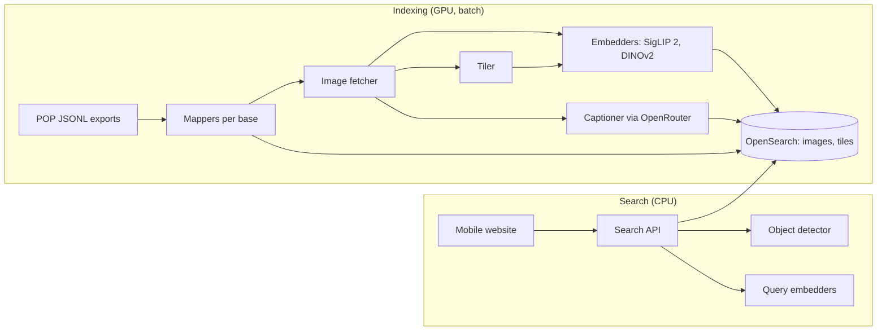

# MIROIR: technical specification

Status: draft for the PoC. Last updated 2026-10-12. Read [functional-spec.md](functional-spec.md) first.

## 1. Overview



The indexing pipeline turns POP records into one OpenSearch document per image. Each document holds image vectors and the record's text and filter fields. A second index holds vectors for image tiles, used for detail search. The search API embeds the query, runs one hybrid query (text plus vectors, with filters), groups hits by building or object, and decides between "match" and "not found".

Everything runs in Docker so the stack can move to the Ministry's cloud unchanged. Open models run on our own machines. Closed models, reached through OpenRouter, take part in the experiments as reference points ([experiments.md](experiments.md)).

## 2. Stack

| Part | Choice |
|---|---|
| Language | Python 3.12 for pipeline, API and evaluation |
| API | FastAPI |
| Models | PyTorch with Hugging Face `transformers` |
| Search | OpenSearch with the k-NN plugin (Faiss HNSW) and a hybrid search pipeline |
| Website | SvelteKit with Tailwind, phone-first |
| Captions | A vision model through OpenRouter, picked in week 1 on cost and French quality |
| Deployment | Docker Compose: `opensearch`, `api`, `web`, `worker`. A GPU machine runs the indexing jobs |

## 3. Data

### 3.1 Input

Each POP export is a folder holding `<base>.jsonl` (one record per line, POP field codes), `metadata.json` (the query and count) and `field-docs.json` (field labels). The PoC starts from three exports:

| Export | Records | Kept | Images | Notes |
|---|---|---|---|---|
| `memoire` | 66,000 | 65,989 | 65,989 | One image per record (`IMG`). `VIDEO` lists size variants of the same file, not extra views |
| `joconde` | 33,000 | 32,997 | 54,825 | 12,000 records have 2 or more views |
| `rose-valand` (base `rose-valland`, Mongo collection `mnr`) | 2,400 | 2,400 | 16,961 | Median 4 images per record, max 52 |

"Kept" counts records left with at least one image after the skips in 3.3: 101,386 records and 137,775 images in all. `uv run miroir records build` writes them to `records.parquet` and `images.parquet` in `MIROIR_DATA_DIR`, and warns when a count differs from this table.

In week 4 the project lead supplies a full export of every POP record with an image, in the same format. It will include bases with no mapper yet (Mérimée, Palissy and others). Section 3.2 limits each new mapper to the fields search needs.

### 3.2 Common record model

Every mapper turns a POP record into this shape:

| Field | Type | Source examples |
|---|---|---|
| `ref` | keyword | `REF` |
| `collection` | keyword | `base`: `joconde`, `memoire` or `rose-valland` |
| `entity_id` | keyword | Mémoire: first `LBASE` value starting with `PA` (building) or `PM` (object), else `REF`. Other bases: `REF` |
| `title` | text | Joconde/Rose Valland `TITR`; Mémoire `EDIF`, then `LEG`. Empty for 11,760 Joconde records: show `denomination` instead |
| `description` | text | Joconde/Rose Valland `DESC` then `HIST`; Mémoire `LEG`. Joined, first 2,000 characters |
| `denomination` | keyword[] | `DENO`, `MCL` |
| `domain` | keyword[] | `DOMN`, `DOM` |
| `authors` | keyword[] + text | `AUTR`, `AUTP` |
| `period` | keyword[] | `EPOQ`, `PERI`, `MILL`, decade of `DATPV` ("années 1940") |
| `region`, `departement`, `commune` | keyword | `REGION`/`REG`, `DPT`/`DPT_LETTRE`, `VILLE_M`/`COM` (first value; `departement` is the name, not the number) |
| `publishable` | boolean | `false` when Joconde `DIFFU` is "non" or Mémoire `DIFF` asks for permission |
| `pop_url` | keyword | `https://pop.culture.gouv.fr/notice/<mongo collection>/<REF>` |
| `images[]` | object | see 3.3 |

### 3.3 Images

- **Source.** Fetch from the POP asset bucket: Joconde and Mémoire `IMG`, Rose Valland `VIDEO`, all relative to the `imageUrl` host. For Mémoire, `IMG` is already the largest variant. `images.parquet` stores the percent-encoded URL. Some files are missing from the bucket (for example some names with accents return 404); the IIIF manifest (`iiif_manifest`, IIIF v3, level-2 image service) serves as fallback and for larger sizes.
- **Image id.** First 16 hex characters of SHA-1 over `ref` and `url`, so it never depends on row order.
- **Skip:**
  - the shared 1×1 placeholder GIF, which `imageUrl` holds when a record lists no image (3 Joconde, 1 Mémoire)
  - `sur_demande.jpg` ("image on request", 10 Mémoire records)
  - the same path listed twice in one record (1 Joconde, 8 Rose Valland)
  - records left with no image are dropped (14). An earlier draft counted 939 Mémoire records carrying "a note instead of a file"; the July 2026 export has none. 60 Mémoire records hold a note ("NUMÉRISÉ : …") in `VIDEO`, but their `IMG` file exists
- **Image type.** Taken from file-name keywords, case and accents ignored. The first rule that matches wins:

  | Type | Keywords | Count in Rose Valland |
  |---|---|---|
  | `label` | `etiquette`, `cachet`, `marque` | 1,518 |
  | `inscription` | `inscription`, `signature` | 1,457 |
  | `back` | `revers`, `verso`, `dos` (not inside a word like "calvados"), Louvre `R-ENS` / `R-DET` | 2,038 |
  | `detail` | `detail`, Louvre `F-DET` | 1,351 |
  | `main` | anything else | 10,597 |

  The order puts what the image shows (a label, an inscription) before where it is (the back) and how it is framed (a detail): "detail-etiquette-au-revers" is a `label`. Joconde has 2 `back` images; Mémoire has none. The first `main` image of a record is its cover; a record with no `main` image uses its first image.
- **Storage.** No local image store. Model work runs remotely (OpenRouter where it has the model, else Hugging Face Jobs), and those jobs read images from their URLs in `images.parquet`, resized to 1,024 px on the longest side. Vectors come back to `MIROIR_DATA_DIR/vectors/`, keyed by `image_id`.

## 4. Models

The models below are the starting point only. [experiments.md](experiments.md) compares them with every serious alternative: Qwen3-VL-Embedding, EmbeddingGemma 2, DINOv3, MegaLoc, SAM 3, geometric re-ranking and others. The winners replace them. Open models are preferred. A closed model enters the stack only if it wins by more than the error bar.

| Job | Starting point | Also try | Why |
|---|---|---|---|
| Same-object matching (F1, F4, F5) | DINOv2 ViT-L/14 | DINOv3 ViT-L | Self-supervised features match the *same* object across views better than text-aligned models do |
| Words ↔ image (F2) and a second signal for F1 | SigLIP 2 so400m | SigLIP 2 base | Multilingual text encoder, so French queries work |
| Finding objects in a photo (F4) | OWLv2 with prompts ("painting", "sculpture", "building", "vase", "furniture"…) | Grounding DINO | Open-vocabulary boxes. Score on the 15 Jeu de Paume room photos |
| Captions | A vision model through OpenRouter | | Mémoire captions (`LEG`) have a median of 51 characters. A French visual description makes them searchable by words |

Vectors are L2-normalised, so we score with inner product. Their size depends on the model chosen: 1,024 for DINOv2 ViT-L and 1,152 for SigLIP 2 so400m.

Captions are written only for records where `publishable` is true. During experiments, test queries come from the collections and Commons, so they can go to closed models. Testers' photos go to a closed model only if one wins a place in the stack and the testers agreed in writing.

## 5. Indexes

### 5.1 `images`: one document per image

```json
{
  "settings": { "index": { "knn": true } },
  "mappings": {
    "properties": {
      "image_id":    { "type": "keyword" },
      "image_type":  { "type": "keyword" },
      "image_url":   { "type": "keyword", "index": false },
      "ref":         { "type": "keyword" },
      "entity_id":   { "type": "keyword" },
      "collection":  { "type": "keyword" },
      "title":       { "type": "text", "analyzer": "french" },
      "description": { "type": "text", "analyzer": "french" },
      "caption":     { "type": "text", "analyzer": "french" },
      "authors":     { "type": "text", "fields": { "kw": { "type": "keyword" } } },
      "denomination":{ "type": "keyword" },
      "domain":      { "type": "keyword" },
      "period":      { "type": "keyword" },
      "region":      { "type": "keyword" },
      "departement": { "type": "keyword" },
      "commune":     { "type": "keyword" },
      "dino":   { "type": "knn_vector", "dimension": 1024, "method": { "name": "hnsw", "engine": "faiss", "space_type": "innerproduct" } },
      "siglip": { "type": "knn_vector", "dimension": 1152, "method": { "name": "hnsw", "engine": "faiss", "space_type": "innerproduct" } }
    }
  }
}
```

We copy record fields onto every image document. Filters and text matching then work in the same query as the vectors, and the API groups by `entity_id` afterwards.

### 5.2 `tiles`: detail search (F5)

Each image is cut into 1 + 4 + 9 overlapping tiles (whole, 2×2, 3×3, with 25% overlap). Only `dino` is stored, with `image_id`, `entity_id` and the filter fields. That gives about 14 vectors per image, so roughly 1.9 million for the first 138,000 images.

Index Rose Valland first. Extend to all images if the score is good and memory allows. Use Faiss byte or fp16 encoding if memory runs short.

### 5.3 Hybrid search pipeline

```json
PUT /_search/pipeline/miroir-hybrid
{
  "phase_results_processors": [
    { "normalization-processor": {
        "normalization": { "technique": "min_max" },
        "combination": { "technique": "arithmetic_mean", "parameters": { "weights": [0.2, 0.5, 0.3] } }
    } }
  ]
}
```

The weights apply to `[text, dino, siglip]`. We tune them on the test sets, and the API drops the subqueries a search doesn't need (no text query, no photo).

## 6. Search API

### 6.1 Endpoints

| Method | Path | Does |
|---|---|---|
| `POST` | `/detect` | Takes a photo and returns boxes with labels and scores |
| `POST` | `/search` | Takes a photo and/or a box and/or text, plus filters. Returns grouped results and a match flag |
| `GET` | `/records/{ref}` | Returns a record with all its images |
| `GET` | `/facets` | Returns filter values with counts for the current search |

### 6.2 `/search` steps

1. Crop the photo to the box, if one was given.
2. Embed the crop with DINOv2 and SigLIP 2. Embed any text with SigLIP 2.
3. Run a hybrid query on `images`: `match` on `title`, `description`, `caption`, `authors` plus `knn` on `dino` and `siglip`, with the filters as a top-level `filter`. Return the top 200 hits.
4. If a box was given, also run `knn` on `tiles` and merge the two lists by reciprocal-rank fusion.
5. Group hits by `entity_id` and score each group by its best hit. Within the group, keep the best-matching image to display and the cover image.
6. Compare the top group's DINOv2 similarity with the "not found" cut-off (6.3). Return `match: true|false` and the top 20 groups.

Target: under 3 seconds per search on CPU, detection included.

### 6.3 "Not found" cut-off

Build a set of queries whose answer is *not* in the index by removing their records before searching (set T8, section 7). Choose the lowest cut-off that keeps confident-but-wrong answers under 5% on that set. Then report the match rate it leaves on the in-index queries.

## 7. Evaluation

This section defines the test sets. [experiments.md](experiments.md) says how we use them to compare options: halves, measures, error bars and rounds.

Every test set is a JSONL of `{query_image or query_text, box?, expected_entity_ids}`, stored as `eval/sets/<set>/{tune,sealed}.jsonl`. `uv run miroir eval run` scores a pipeline configuration against a set and writes `eval/results/<round>/<step>-<option>.json`, which is committed. Code gets both paths from `miroir.config`, which refuses to open a sealed half outside R4.

During evaluation, the query image and every other image of the same *photo record* are removed from the index, so a query cannot find itself.

| Set | Built from | Size | Metric | Target |
|---|---|---|---|---|
| T1 Archive building | Mémoire buildings (`PA`) with 2+ photos (3,262 buildings). One photo per building is the query; the others are the answer. At most 1 query per building | 1,000 queries | Right building in top 10 | ≥ 80% |
| T2 Phone building | Wikimedia Commons photos of buildings in T1, found through Wikidata's Mérimée ID (P380). Keep GPS from the photo metadata where present | ≥ 300 queries | Right building in top 10 | ≥ 60% |
| T3 Room photos | 15 Jeu de Paume room photos (Rose Valland `JDP-*`) and the 231 paintings that link to them through `RENV`. Hand-drawn boxes for each painting are the reference. Detectors are scored against them | 231 queries | Right record in top 5 | ≥ 70% |
| T4 Details | Rose Valland `detail` images, with the record's other images left in the index | up to 1,000 queries | Right record in top 10 | Report |
| T5 Objects, other view | Joconde records with 2+ images: one view is the query | 1,000 queries | Right record in top 10 | Report |
| T6 Words, by hand | 50 French descriptions written by hand, judged by hand | 50 queries | Relevant record in top 10 | Report |
| T7 Words, generated | For a hidden image, a vision model writes the short French description a member of the public might type. The answer is that image's record. The writer must come from a different model family than the option being scored | 1,000 queries | Right record in top 10 | Report |
| T8 Not found | Queries from T1, T2 and T5 whose whole entity has been removed from the index | 500 queries | Wrong-but-confident rate at the chosen cut-off | < 5% |
| T9 Public benchmarks | AmsterTime (modern vs archive street photos) and Met (museum art) | as published | As in the published papers | Within 2 points of published scores, as a harness check |

## 8. Website

- **Stack.** SvelteKit with Tailwind, built phone-first. The camera opens through `<input type="file" accept="image/*" capture="environment">`.
- **Photo view.** After upload, the site calls `/detect` and draws the boxes. Tapping a box, or drawing a new one, calls `/search` with that box.
- **Results.** One card per group: best-matching image, title, place, collection and a link to POP. A "matched on: back of canvas" tag appears when the hit image isn't `main`. A banner shows when `match` is false.
- **Login.** Accounts created by an admin and stored hashed in the API's database. No sign-up page.

## 9. Logging and privacy

- **What we log:** each search's query (image hash, box, text, filters), returned refs and timing. Query images are stored only for logged-in testers who agreed in writing.
- **Deletion:** test photos and logs are deleted at the end of the PoC.
- **Third parties:** only `publishable` collection images, Commons photos and test-set queries go to outside model services. Testers' photos stay on our machines unless the rule in §4 applies.

## 10. Repository layout

```
miroir/
  pyproject.toml   one uv project, Python 3.12; extras `jobs` (torch…, for remote jobs only) and `api` (FastAPI)
  Makefile         `make check` (ruff, pyright strict, pytest), `make fmt`
  CLAUDE.md, CODING_STANDARDS.md
  docs/            functional-spec.md, technical-spec.md, experiments.md, results.md
  src/miroir/
    config.py      every setting and path (MIROIR_DATA_DIR, MIROIR_EXPORTS_DIR)
    cli.py         the `miroir` command; every entry point is a subcommand
    records/       record model, mappers per base, Parquet store  (`miroir records build`)
    images/        image helpers (URLs, tiles); no local image store
    jobs/          remote model work: OpenRouter calls, Hugging Face Jobs (code run there may use `jobs`)
    index/         OpenSearch mappings and loading
    eval/          test set builders, scoring
    api/           FastAPI app (needs the `api` extra)
  tests/           unit tests; fixtures/ holds real export lines
  eval/            sets/, results/ (committed)
  web/             SvelteKit app
  docker-compose.yml
```

`records/`, `images/` and `eval/` exist today; the others are created when their work starts. Data and images live outside the repository, in `MIROIR_DATA_DIR` (default `~/miroir-data`). The exports are read from `MIROIR_EXPORTS_DIR` and never written to.

## 11. Sizing

| Item | First 101k records | Full POP |
|---|---|---|
| Images | about 138,000 | Unknown until the export |
| Image vectors | 2 × 138,000 | 2 × images |
| Tile vectors | about 240,000 for Rose Valland, about 1.9 million for all | about 14 × images |
| Embedding time | a few hours on one GPU | scale linearly |

## 12. Open technical questions

1. Which POP bases does the full export contain, and how many images? Answered when the export arrives (week 4).
2. Is the POP asset bucket fast enough to download millions of images, or do we need a bulk copy from the POP team?
3. Does fp16 or byte encoding of tile vectors cost too much accuracy on T4?
